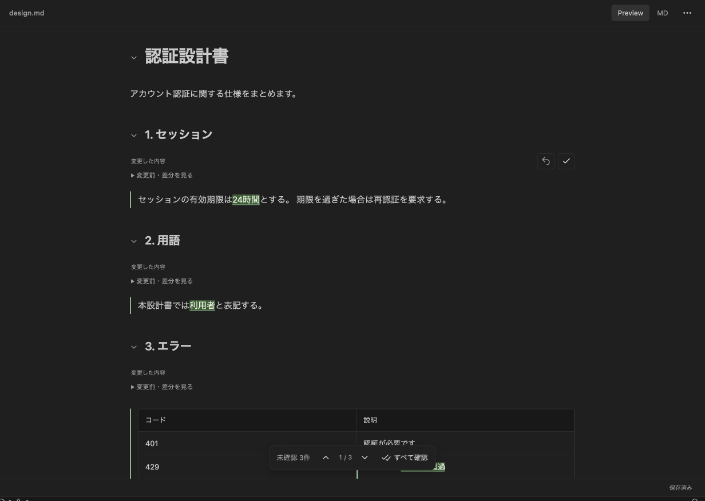
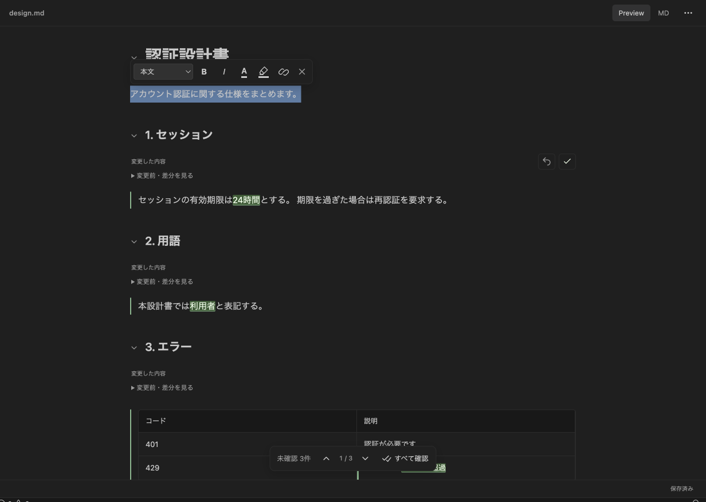
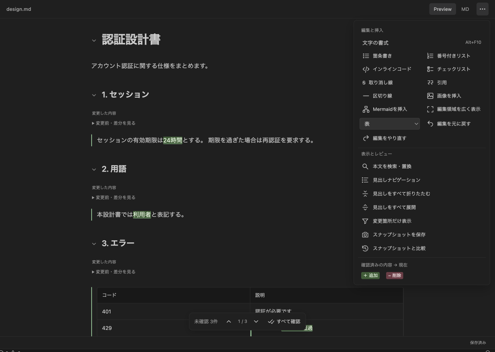
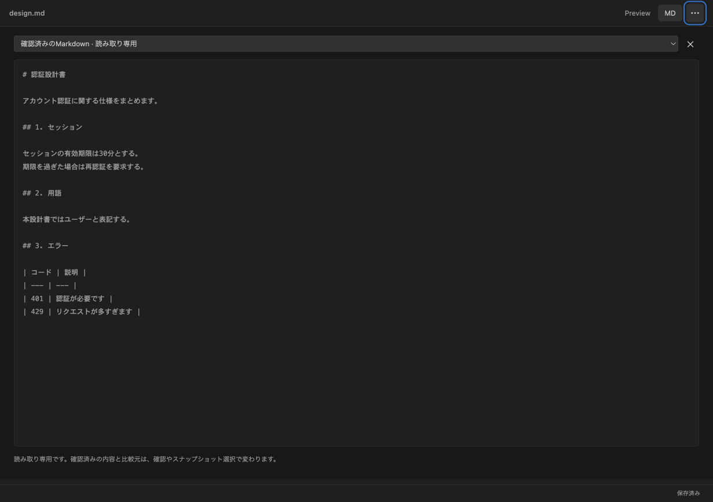
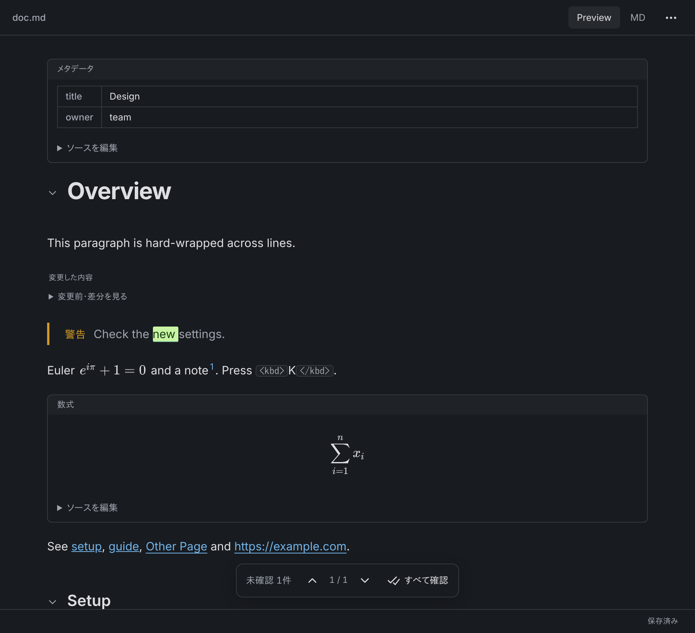

# Markdown Lens — WYSIWYG & Review

**AIが直した設計書を、見て・直して・確認する。**

変更箇所をマーカーで確認し、本文をそのまま編集できる **VS Code / Cursor向けMarkdown拡張** です。変更の近くにある「戻す」「確認済み」で、1件ずつレビューできます。アカウント・AI APIキーは不要です。



**緑のマーカーで変更を見つける → 必要ならその場で編集 → ↶ 戻す / ✓ 確認済み。**

> このREADMEは **0.14.0** の機能を紹介しています。操作画面は0.13.0、その他の機能画像は0.9.0〜0.12.0のサンプル文書を使って **VS Codeの実際の拡張画面** を撮影したものです。0.14.0の記法表示の画像は、同じWebviewを検証用ブラウザーで表示したものです。ストア表示名は **Markdown Lens — WYSIWYG & Review**、コマンド名は **Markdown Lens** です。画像内には旧表示名が含まれます。

上部の **Preview** で見たまま編集し、**MD** で元のソースへ切り替えます。編集・差分確認・戻す・確認済みを、ひとつのPreviewで行えます。変更前は各変更の「変更前・差分を見る」で開きます。

文字を選ぶと書式バー、表を選ぶと行・列の操作が表示されます。検索・目次・画像の挿入・折りたたみ・スナップショットは **⋯** から開けます。書式バーは **Alt+F10** でも開き、**Esc** で閉じられます。



<details><summary>その他の操作メニューを見る</summary>



</details>

## できること

| やりたいこと | Markdown Lensでできること |
| --- | --- |
| AIがどこを直したか知りたい | 本文・表・図の変更を強調。変更前もその場で確認 |
| 読みながら直したい | WYSIWYGで直接編集し、下書きの差分を更新 |
| 重要な言葉に色を付けたい | [文字色・マーカーを選び、文書へ保存](#colors) |
| 元のMarkdownも見たい | [PreviewとMDを切り替え](#source)。現在・確認済み・比較元を切り替え |
| 変更セルだけ確認したい | [セル単位で戻す・確認済みにする](#cell-review) |
| 用語をまとめて直したい | [本文の検索・置換、変更箇所だけ検索](#find) |
| 図をすぐ文書に入れたい | 画像を貼り付け、相対パスで挿入 |
| 作業の続きに戻りたい | ファイルごとに表示位置・折りたたみ・ソースの開閉を復元 |
| 表を手早く整えたい | [行列の追加・移動・削除と自動採番](#tables) |
| 長い表を読みたい | [表の拡大・列幅調整・セルの前後比較](#table-review) |
| 図の変更も確認したい | [Mermaidの変更前・差分・変更後を表示](#mermaid) |
| 長い設計書を見渡したい | [目次で移動](#find)、[見出しで折りたたみ](#folding)。未確認件数も表示 |
| 作業を区切って確認したい | 未確認ファイル一覧、確認の取り消し、スナップショット比較 |
| frontmatter・数式・HTMLを崩したくない | [編集しても原文の記法を保持](#syntax)。数式・アラート・脚注も表示 |
| コミットとの差分を見たい | [Gitと比較、比較元をGit HEADにする](#git) |
| リンク切れを見つけたい | [相対リンク・画像・見出しアンカーを確認](#links) |
| 変更をまとめて共有したい | [変更の要約をMarkdownで書き出す](#git) |
| 英語で使いたい | VS Codeの表示言語が日本語以外なら英語で表示（[English](#english)） |

## まず使ってみる

### インストール

0.14.0では、編集してもMarkdownの記法（折り返し・HTML・frontmatter・数式など）を変えないようにし、Git連携・リンク確認・英語表示を追加しました。0.14.1では、表（列幅と長いセルの折りたたみ）・書式タグ・アラート・コードブロックなどの見やすさを改善し、コードブロックのコードが表示されない問題を修正しました。Marketplaceでは0.14.1を公開しています。

**VS Code:** 拡張機能パネルで `@id:iam74k4.markdown-lens-review` を検索してインストールします。発行者は **iam74k4** です。

**Cursor / VSIXでのインストール:** コマンドパレットで **Extensions: Install from VSIX...** を実行し、`markdown-lens-0.14.1.vsix` を選びます。更新後、古い画面が残る場合はウィンドウを再読み込みしてください。

Cursor向けOpen VSXは公開準備中のため、CursorではVSIXからインストールしてください。0.14.1のVSIXが手元にない場合は、以下の手順でこのリポジトリから作成できます。

<details>
<summary>VSIXの作り方（Node.js 22.12以降）</summary>

リポジトリを取得し、そのルートフォルダで実行します。

```sh
npm ci
npm run package -- --out markdown-lens-0.14.1.vsix
```

拡張を使う側にはNode.jsは不要です。

</details>

ローカル版（発行者 `local-markdown-review`）からの移行は [移行案内](docs/guide.md#ローカル版からの移行) を参照してください。公開準備と登録手順は [公開ガイド](docs/PUBLISHING.md) にまとめています。

### レビューの流れ

1. **AIに修正を頼む前に**作業フォルダーを開き、エクスプローラーの **Markdown Lens · 未確認** が「監視中」になるのを待ちます。Gitで管理している場合は、設定 `markdownLens.initialBaseline` を `gitHead` にすると、最後のコミットからの変更をすぐに確認できます。
2. Markdownファイルを開き、**Markdown Lens: 変更プレビューを開く** を実行します。
3. Claude Code・Codex・Cursor・手動で同じファイルを編集すると、差分が自動で更新されます。
4. マーカーを確認し、**↶ 戻す** または **✓ 確認済み** を選びます。本文を直接直すこともできます。

**「確認済み」はレビューの基準を更新する操作です。ファイル保存やGitコミットはしません。** 編集・復元した内容は「保存」または `⌘S` / `Ctrl+S` でファイルへ反映します。

<a id="cell-review"></a>
## 表の変更は、セルごとに確認

変更セルのそばにある **↶ / ✓** で、そのセルだけを戻す・確認済みにできます。他のセルはそのまま残ります。確認直後の「取り消す」にも対応します。


セルは同じ行・列の位置で対応付けます。行列数や列の配置指定が変わった表は、従来の表全体のレビューを使います。セルの確認は比較元だけを更新し、セルを戻した内容は明示保存でファイルへ反映します。

<a id="find"></a>
## 検索と目次を、必要なときだけ開く

**⋯ → 本文を検索・置換**、または **⌘F / Ctrl+F** で本文を検索・置換できます。太字などの書式をまたぐ文字にも対応し、**変更箇所だけ** を選ぶと未確認の変更ブロックに絞れます。まとめて置換しても1回のUndoで取り消せます。


**⋯ → 見出しナビゲーション** で見出しと未確認件数を表示。クリックすると折りたたまれた節も開いて移動します。タブを閉じて開き直すと、前回の表示位置・折りたたみ・ソースの開閉状態から再開できます。

## スクリーンショットを、そのまま貼り付け

本文または編集可能なソース欄へ画像を貼り付けると、Markdownの隣の `.markdown-lens-images` に保存して相対パスを挿入します。PNG・JPEG・GIF・WebP、1枚10MBまで。画像ファイルは貼り付け時に作成され、Markdownへの反映は **保存** で行います。Undoで挿入を取り消しても、保存済み画像は残します。

<a id="colors"></a>
## 文字色・マーカーで、重要な言葉を強調

文字を選択し、ツールバーの **A（文字色）／マーカー** を押します。8色のパレットから選ぶだけで適用でき、カラーピッカーや `#RRGGBB` 形式で好きな色も指定できます。


本文・見出し・表のセル内で使えます。文字色とマーカーは重ねて適用でき、それぞれ解除・Undoできます。変更は下書きとして保持され、**保存**で同じ `.md` ファイルに反映されます。

> 色付き部分は `<span style="color:#3984d5">` や `<mark style="background-color:#fff2a8">` で保存します。Markdown Lensでは再表示・編集できます。色はMarkdownの標準仕様ではなく、GitHubなど表示先によって再現されない場合があります。

<a id="tables"></a>
## 表は、行・列をワンタッチで操作

セルを選ぶと、表のすぐ上に操作ボタンが表示されます。行の **＋ / ↑ / ↓ / ゴミ箱**、列の **＋ / ← / → / ゴミ箱** で追加・移動・削除できます。追加後は新しいセルへ移り、そのまま入力できます。


**番号列を選んで「連番」をオン**にすると、行の追加・削除・移動後に1から振り直します。画面例では中央の行を削除し、No列は `1・2`、ID列は `101・999` のままです。操作はUndoで戻せます。

<a id="table-review"></a>
## 長い表は広く開き、変更セルを比較

表の変更箇所にある **変更前・差分を見る → 広く表示** を選ぶと、表に集中できます。見出し・先頭列を固定し、列幅の調整、変更行だけの表示、分類列でのグループ表示ができます。


セルを選ぶと、下部に**変更前・変更後と全文**を表示します。表示幅やグループを変えても、Markdownの内容は変わりません。

<a id="mermaid"></a>
## Mermaidも、文章と一緒にレビュー

`mermaid` のコードブロックを図として表示します。基本的なフローチャートでは、**追加を緑、削除を赤、変更を黄**で強調し、「変更前 / 差分 / 変更後」を切り替えられます。


Mermaidソースを直接編集すると、図も更新されます。複雑な図は変更前後を並べて比較します。ワークスペース内のローカル画像も本文と一緒にプレビューできます。

<a id="source"></a>
## 本文を編集しながら、元のMarkdownも見る

上部の **MD** でソース画面へ切り替えます。現在のMarkdownは直接編集でき、「確認済み」「比較元」は読み取り専用で確認できます。



通常は **Preview** で編集と確認を続け、前後を詳しく見たい箇所だけ **変更前・差分を見る** で展開します。本文とソースは、どのウィンドウ幅でも一画面ずつ切り替えます。Previewへ戻ると、本文の読んでいた位置を復元します。

<a id="folding"></a>
## 必要な見出しだけ開く

見出し左の **⌄ / ›** で、子見出し・本文・表・画像・Mermaidをまとめて開閉します。**⋯** には **すべて折りたたむ / すべて展開** もあります。


折りたたみ中も**変更件数**を表示。「次の変更」で移動すると、対象の節を自動で開きます。**変更箇所だけ表示**と併用できます。

<a id="syntax"></a>
## 編集しても、Markdownの書き方はそのまま（0.14.0）

Previewで段落を1文字直しても、その段落の書き方は変わりません。編集していない段落は従来どおり1バイトも変えません。



| 記法 | 表示 | 編集後の保存 |
| --- | --- | --- |
| 折り返した段落・日本語の改行 | 1つの段落として表示 | 改行の位置と字下げを保持 |
| frontmatter（`---` / `+++`） | メタデータの表 | 原文どおり。「ソースを編集」で直接編集 |
| `> [!NOTE]` などのアラート | 色付きの注記 | 原文どおり |
| 脚注 `[^1]` | 番号。⌘/Ctrl+クリックで定義へ移動 | 原文どおり |
| 数式 `$…$` / `$$…$$` | KaTeXで表示 | 原文どおり。ダブルクリックで編集 |
| HTML・HTMLコメント | ソースとして表示。`<kbd>` `<sub>` `<sup>` などは表示 | 原文どおり |
| Wikiリンク `[[Page]]` | リンク。⌘/Ctrl+クリックで開く | 原文どおり |
| `-` `+` の箇条書き、`1)`、`_斜体_`、`~~~`、Setext見出し | 通常どおり | 記号を保持 |
| 表 | 通常どおり | 編集していない行と、セルの余白を保持 |

数式・HTML・脚注などは、ダブルクリック（または選択してEnter）で1行のMarkdownとして直接編集できます。見出しの改行など、Previewで安全に編集できない構造は、内容を失わないようMD画面での編集に切り替えます。

入力中に `**太字**`、`*斜体*`、`` `コード` ``、`~~取り消し~~` と打つと書式になり、行頭の ```` ``` ```` はコードブロック、`---` は区切り線になります。

<a id="links"></a>
## リンクを開く・リンク切れを見つける

**⌘/Ctrl+クリック**でリンクを開きます。Markdownは変更プレビューで、`#見出し` は文書内の見出しへ、Wikiリンクはワークスペースから探して開きます。外部のURLは確認してからブラウザーで開きます。

相対リンク・画像・見出しアンカー・Wikiリンクの行き先が見つからない場合は、波線と「⚠ リンク切れ」、VS Codeの「問題」パネルに表示します。外部URLにはアクセスしません。

<a id="git"></a>
## Git・テキストエディターと連携

- **Gitと比較** — 「⋯ → スナップショット・Gitと比較」でHEAD・ブランチ・このファイルのコミットと比較します。確認済みの状態は変わりません。
- **比較元をリセット** — 確認済みの内容を、Git HEAD・任意のリビジョン・現在の内容・空の文書に置き換えます。初回読み込みより前の変更も確認できます。直後なら「取り消す」で戻せます。
- **新しいファイル** — 監視を始めた後に作成されたMarkdownは、全文を「追加」として未確認にします（`markdownLens.newFiles`）。
- **名前変更** — VS Codeでの名前変更・フォルダー移動や、AIツールによる移動でも、比較元・下書き・スナップショットを引き継ぎます。
- **変更の要約** — 「変更の要約を書き出す」で、未確認の変更を見出しの位置付きの差分一覧にします。PRの説明やレビュー依頼に使えます。
- **テキストエディター** — 行番号の横と概要ルーラーに未確認の変更を表示し、ステータスバーに件数を表示します。`Alt+F3` / `Shift+Alt+F3` で前後の変更へ移動し、「確認済みの内容とのテキスト差分を開く」でVS Codeの差分エディターを開きます。
- **別のエディターで開く** — 「別のエディターで開く… → Markdown Lens」で、Markdownファイルを直接Markdown Lensで開けます。既定のエディターにも設定できます。

## 設定

| 設定 | 既定値 | 内容 |
| --- | --- | --- |
| `markdownLens.initialBaseline` | `content` | 初めて読み込んだファイルの比較元。`gitHead` で最後のコミット |
| `markdownLens.newFiles` | `unreviewed` | 監視開始後に作成されたファイルを未確認にする（`reviewed` で確認済み） |
| `markdownLens.excludeFolders` | `node_modules` など | 監視しないフォルダー名 |
| `markdownLens.maxFiles` | `1000` | 監視するファイル数の上限 |
| `markdownLens.maxFileSizeKB` | `512` | 比較・編集できるファイルサイズ（128〜4096） |
| `markdownLens.imageFolder` | `.markdown-lens-images` | 貼り付けた画像の保存先（Markdownからの相対パス） |
| `markdownLens.pollInterval` | `1500` | 表示中のプレビューがファイルを再確認する間隔（ミリ秒、`0`で無効） |
| `markdownLens.editorDecorations` / `statusBar` | `true` | テキストエディターの表示・ステータスバーの件数 |
| `markdownLens.validateLinks` | `true` | リンク切れの確認 |
| `markdownLens.math` | `true` | 数式をKaTeXで表示（オフでもソースは保持） |
| `markdownLens.storageRetentionDays` | `14` | 削除されたファイルの保存データを自動で消すまでの日数（`0`で保持） |

## レビューを続けやすくする機能

- **未確認一覧** — エクスプローラーにファイル名と変更件数を表示。レビュータブを閉じても監視を続けます。
- **確認の取り消し** — 確認後の「取り消す」で、直前の確認を未確認に戻せます。
- **スナップショット** — カメラで現在の状態を保存し、履歴からその時点と比較できます。
- **下書きの保持** — 編集中に外部更新が入っても下書きを上書きせず、競合を表示します。

## 知っておきたいこと

- 初回読み込み前の変更は、Gitで管理していればGitの比較元で確認できます。Gitがない場合は **AI編集前に監視を開始**してください。
- 比較元・下書き・スナップショットは拡張専用ストレージに保存します。ネットワーク送信・AI呼び出し・テレメトリーはありません。
- 確認・復元は段落などのブロック単位。表はセル単位にも対応し、行列の構成が変わった場合は表全体が対象です。
- 見出しの折りたたみは文書ごとに保存します。自動採番の列指定はレビュータブ内で保持し、新しく開いたタブでは再設定してください。
- Mermaidの図形ドラッグ編集、結合セルには対応していません。HTMLと数式は表示し、原文（Markdown）として編集します。
- 参照リンク `[text][ref]` を含む段落を編集すると、その段落のリンクは `[text](URL)` の形で保存されます（定義は残ります）。
- これは **Markdown Lensの変更プレビュー** の機能です。Cursor標準のMarkdownプレビューを置き換えるものではありません。

[詳しい操作・対応範囲・保存データ・開発手順](docs/guide.md) · [変更履歴](CHANGELOG.md) · [0.8.0時点の全機能レビュー](MAIN_REVIEW.md) · [最新版の検証記録](VALIDATION.md)

<details>
<summary>開発・検証とスクリーンショットの更新</summary>

```sh
npm ci
npm run check
npm test
npm run build
npm run test:tables
npm run test:diagrams
npm run test:rich
```

macOSにVS Codeがある環境では、次のコマンドで実Webviewの検証とREADME用スクリーンショットの撮影を行えます。通常の作業ウィンドウと分離したテスト用プロファイルで実行します。

```sh
MARKDOWN_REVIEW_SCREENSHOTS=docs/images npm run test:ui
```

VS Code / Cursorの拡張ホスト検証は `npm run test:host`。日本語変換はChromiumの入力イベントとCursor上のmacOS実キー入力で検証しています。Cursor実画面では下書き復元・保存・Undo／Redo・折りたたみも追試しました。候補一覧UIや全UI操作など、未検証の範囲は[最新版の検証記録](VALIDATION.md)を参照してください。

</details>

<a id="english"></a>
## English

Markdown Lens shows the changes an AI (or anyone) made to a Markdown file as inline markers on the rendered document. You can edit the document as rendered, and revert or mark each change as reviewed. The UI follows VS Code's display language: Japanese for `ja`, English otherwise.

- **Review** — Open *Markdown Lens: Open Change Preview*. Each change has **Revert** and **Mark as reviewed**; tables can be reviewed per cell. Compare with snapshots or Git revisions, reset the baseline to Git HEAD, and export a Markdown change summary.
- **Edit without reformatting** — Editing a paragraph keeps its line breaks, inline HTML, front matter, GitHub alerts, footnotes, math, wiki links, list markers and table padding exactly as written.
- **Navigate** — ⌘/Ctrl+click opens links; broken relative links, images and anchors are reported. Unreviewed changes appear in the gutter of text editors and in the status bar.
- **Private** — Everything runs locally. No account, API key, network request or telemetry.

## ライセンス

[MIT License](LICENSE)。同梱ライブラリのライセンスは [THIRD-PARTY-NOTICES.txt](THIRD-PARTY-NOTICES.txt) を参照してください。
